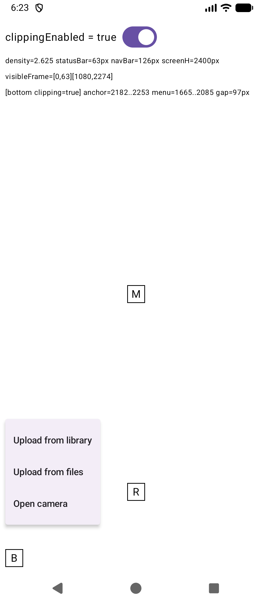
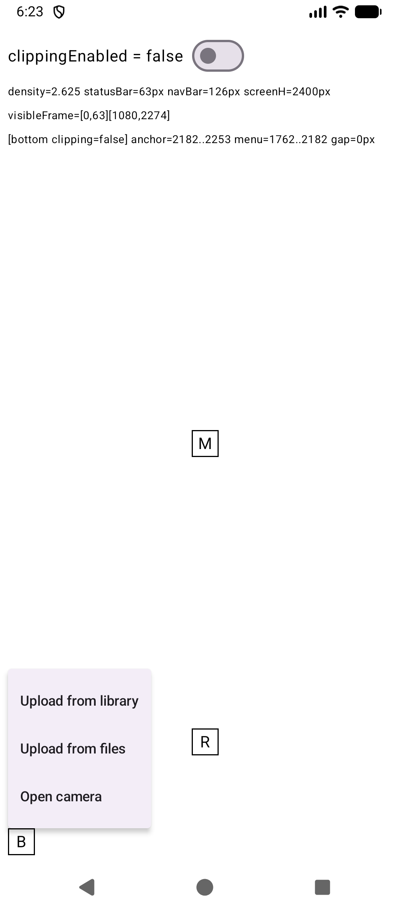

# Compose DropdownMenu detaches from a bottom anchor in edge-to-edge apps

Minimal Compose-only repro (no React Native) for https://github.com/expo/expo/issues/51392.

In an edge-to-edge activity, a Material3 `DropdownMenu` whose anchor sits near the bottom of the
screen opens well above the anchor instead of directly above it.

| `clippingEnabled = true` (default) | `clippingEnabled = false` |
| :--: | :--: |
|  |  |

## Run

```sh
./gradlew :app:installDebug
adb shell am start -n com.example.menurepro/.MainActivity
```

Tap **B** (bottom anchor). **M** (middle) and **R** (100dp above the bottom) are controls.
The switch toggles `PopupProperties.clippingEnabled`. The measured anchor and menu bounds are
printed on screen and to logcat (`adb logcat -s MenuRepro`).

Scripted: `adb shell am start -n com.example.menurepro/.MainActivity --es open bottom --ez clipping true`

Material3 version: `-Pmaterial3Version=<version>` (default `1.5.0-alpha17`).

## Result

Medium Phone emulator, API 37.1, 1080x2400, density 2.625, 3-button nav.

| Material3 (compose-ui) | Anchor | clippingEnabled | Anchor top..bottom | Menu top..bottom | Gap |
| --- | --- | --- | --- | --- | --- |
| 1.5.0-alpha17 (1.11.0-beta02) | bottom | true | 2182..2253 | 1665..2085 | **97px** |
| 1.5.0-alpha17 (1.11.0-beta02) | bottom | false | 2182..2253 | 1762..2182 | 0 |
| 1.5.0-alpha17 (1.11.0-beta02) | raised | true / false | 1919..1990 | 1499..1919 | 0 |
| 1.5.0-alpha17 (1.11.0-beta02) | middle | true / false | 1133..1204 | 1204..1624 | 0 |
| 1.5.0-beta01 (1.12.0) | bottom | true | 2182..2253 | 1665..2085 | **97px** |
| 1.5.0-beta01 (1.12.0) | bottom | false | 2182..2253 | 1762..2182 | 0 |

## Cause

1. `PopupLayout.updatePosition()` (`AndroidPopup.android.kt`) passes
   `windowSize = getDisplayBounds()` width/height only. With `clippingEnabled = true` that is
   `getWindowVisibleDisplayFrame`, here `[0,63][1080,2274]`, so the height is `2211` and the
   status bar offset (`63`) is dropped. The anchor bounds come from `positionInWindow()`, which in an
   edge-to-edge window is measured from the top of the screen. The two are in different coordinate spaces.
2. `DropdownMenuPositionProvider` (`material3/internal/MenuPosition.kt`) only accepts a vertical
   position with `y + menuHeight <= windowSize.height - 48dp`. Here that is `2211 - 126 = 2085`.
   "Above the anchor" needs the menu bottom at `2182`, so it is rejected and the menu is pinned to
   `2085`, 97px above the anchor.

With `clippingEnabled = false`, `windowSize` comes from the full window bounds (`2400`), which matches
the anchor's coordinate space, and the menu opens directly above the anchor.
